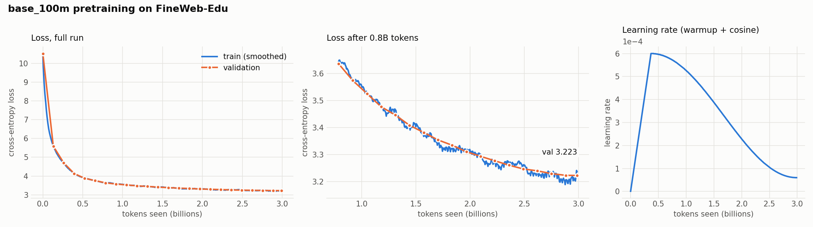

# Llama-style language model from scratch (PyTorch)

A decoder-only transformer, BPE tokenizer and pretraining pipeline written from
the ground up in PyTorch, with no `transformers` or `tokenizers` library.
Each architecture choice sits behind a config flag, so it can be compared against
its alternative under the same training budget.

**Status:** a 100M-parameter model has been pretrained from scratch on 3B tokens of FineWeb-Edu
(one A100, 4.5 hours) and reaches **27.7% on HellaSwag**, against 29.6% for GPT-2 124M
measured with the same script. It is published on the Hugging Face Hub as
[`Efe-Tatar/base-100m-fineweb-edu`](https://huggingface.co/Efe-Tatar/base-100m-fineweb-edu)
in the standard `LlamaForCausalLM` format, verified to match this implementation exactly.

## What's implemented

**Model** ([network/](network/))
- Pre-norm decoder blocks with RMSNorm and a SwiGLU feed-forward
- Rotary position embeddings (RoPE), computed once and shared by all layers
- Grouped-query attention (GQA): any number of KV heads from 1 (MQA) up to `n_heads` (MHA)
- KV cache for incremental decoding (prefill + token-by-token), checked against the full forward pass
- Two attention paths: a hand-written reference and PyTorch's fused `scaled_dot_product_attention`, tested to match
- Weight tying, GPT-2-style scaled init on the residual projections
- `generate()` with temperature, top-k and stop token

**Tokenizer** ([tokenizer/bpe.py](tokenizer/bpe.py))
- Byte-level BPE with a GPT-style pre-tokenization regex
- Training uses incremental pair counts on a heap, with streaming input, so a corpus of hundreds of MB never has to sit in memory as one string
- Special tokens (`<|endoftext|>`, chat roles) and a word-level encode cache

**Training** ([train.py](train.py), [training/](training/))
- FineWeb-Edu streamed, tokenized in parallel and stored as `uint16` shards read with memmap
- AdamW with weight decay on matmul weights only; linear warmup + cosine decay
- Gradient accumulation to a fixed token batch size; gradient clipping
- Mixed precision: bf16 autocast, or fp16 with `GradScaler` on older GPUs
- Multi-GPU with `torchrun` (DDP); optional `torch.compile`
- Logging of tokens/s and MFU; Weights & Biases optional
- Checkpoints save the model, optimizer, data position and RNG state, written atomically. `--resume` continues a run **exactly** (tested: an interrupted run reproduces the uninterrupted one bit for bit)

### Ablation flags

| Flag | Default (Llama) | Alternative (GPT-2 era) |
|---|---|---|
| `--norm` | `rms` | `layer` |
| `--mlp` | `swiglu` | `gelu` |
| `--pos` | `rope` | `learned` |
| `--n_kv_heads` | `4` (GQA) | `12` (MHA), `1` (MQA) |
| `--attn_impl` | `manual` | `sdpa` |

## Results

### Pretraining: `base_100m` on 3B tokens

<picture>
  <source media="(prefers-color-scheme: dark)" srcset="assets/base_100m_training_dark.png">
  
</picture>

| | |
|---|---|
| Model | 100.7M parameters: 768d × 12 layers, 12 heads / 4 KV heads (GQA), RoPE, SwiGLU, RMSNorm, 32k vocab |
| Data | 2.99B tokens of FineWeb-Edu, one epoch (no token seen twice) |
| Batch / schedule | 0.5M tokens per step, 5700 steps, AdamW, LR 6e-4 with 700-step warmup and cosine decay to 6e-5 |
| Hardware | 1× A100 80GB (Google Colab), bf16, `torch.compile`, SDPA attention |
| Throughput | 184k tokens/s, **42% MFU**, 14.9 GB peak memory |
| Time / cost | 4.5 hours, ~31 Colab compute units |
| Final validation loss | **3.223** (perplexity 25.1) |

Training and validation loss track each other the whole way, as expected with no repeated data.
Full log: [runs/base_100m/train_log.txt](runs/base_100m/train_log.txt).

**HellaSwag** (10,042 validation questions, pick the right ending out of 4), scored by
[evaluation/hellaswag.py](evaluation/hellaswag.py) with identical code for both models:

| Model | Params | Training tokens | acc | acc_norm |
|---|---|---|---|---|
| random guessing | | | 25.0% | 25.0% |
| **ours, `base_100m`** | 100M | 3B | 27.7% | **27.7%** |
| GPT-2 124M (OpenAI) | 124M | undisclosed, far more | 28.7% | 29.6% |

The model closes about 60% of the gap between chance and GPT-2 124M after 3B tokens.
The GPT-2 score matches its published value, which validates the evaluation. Public GPT-2
reproductions on FineWeb-Edu reach GPT-2's level after roughly 5-10B tokens, so the remaining
gap is the training budget, the next lever to pull.

Sample after training (prompt "The", temperature 0.8):

> The impact of the COVID-19 pandemic on public health is being felt everywhere. The COVID-19
> pandemic has affected every aspect of our lives. From the initial COVID-19 public health crises
> to the response to the COVID-19 pandemic, ...

Fluent and on topic, but repetitive and shallow: typical for a 100M model.
Try it with [colab/playground.ipynb](colab/playground.ipynb).

### Inference

Greedy generation with this project's own inference code, `base_100m`, batch 1, fp32,
on a 10-thread laptop CPU ([tools/benchmark_inference.py](tools/benchmark_inference.py)):

| New tokens | Without KV cache | With KV cache | Speed-up |
|---|---|---|---|
| 128 | 4.5 tok/s | 20.4 tok/s | 4.5× |
| 512 | 1.9 tok/s | 21.9 tok/s | **11.6×** |

- Without the cache, every new token recomputes the whole sequence, so generation slows down as the text
  grows. With it, speed stays flat. Both produce identical tokens.
- Grouped-query attention (4 KV heads for 12 query heads) makes the KV cache **3× smaller**:
  12 MiB per 1024-token sequence in bf16, against 36 MiB with full multi-head attention.
- The same weights run through Hugging Face's `LlamaForCausalLM` give identical tokens at about the
  same speed (21.2 tok/s vs 21.9 tok/s here).

### Hugging Face export

[tools/export_hf.py](tools/export_hf.py) converts a checkpoint to `LlamaForCausalLM` + a fast tokenizer,
and [tools/load_hf.py](tools/load_hf.py) converts back. The two RoPE layouts differ (this code rotates
neighbouring dimensions, HF rotates dimension *i* with *i + d/2*), so the Q/K projection rows are
reordered per head. Tests check identical token ids, logits equal to within 1e-5, identical greedy
generation, and a bit-exact round trip.

### Tokenizer

32k-token byte-level BPE trained on 300M characters of FineWeb-Edu (144 s), compared with
GPT-2's and GPT-4's tokenizers on text it never saw during training. Characters per token,
higher is better (fewer tokens for the same text):

| Text | Ours (32k) | GPT-2 (50k) | GPT-4 (100k) |
|---|---|---|---|
| FineWeb-Edu, held out | **4.62** | 4.62 | 4.80 |
| Sherlock Holmes (Gutenberg) | **3.75** | 3.62 | 4.09 |
| Shakespeare | 3.18 | 3.30 | 3.70 |
| Python (this repo) | 2.16 | 2.39 | 3.63 |

On modern English prose it matches or beats GPT-2 with a 35% smaller vocabulary, and stays
within 4% of GPT-4's on its own domain. It is slightly behind GPT-2 on Shakespeare's Early
Modern English, and weakest on code: the training data contains almost none, while GPT-4's
tokenizer was trained on large amounts of it. Reproduce with
[tokenizer/evaluate.py](tokenizer/evaluate.py).

### Data pipeline

3B tokens of FineWeb-Edu encoded into `uint16` shards in 26 min, **1.9M tokens/s** on a
12-core CPU, in pure Python, using multiprocessing and a word-level encode cache. The cache
alone made encoding about 11× faster (173k → 1.9M tokens/s).

## Use the trained model

With plain `transformers`:

```python
from transformers import AutoTokenizer, AutoModelForCausalLM

tok = AutoTokenizer.from_pretrained("Efe-Tatar/base-100m-fineweb-edu")
model = AutoModelForCausalLM.from_pretrained("Efe-Tatar/base-100m-fineweb-edu")

ids = tok("<|endoftext|>Photosynthesis is the process by which", return_tensors="pt").input_ids
out = model.generate(ids, max_new_tokens=60, do_sample=True, temperature=0.8, top_k=50)
print(tok.decode(out[0][1:]))
```

As an HTTP API running on this project's own inference code ([serve/app.py](serve/app.py), FastAPI):

```bash
pip install -r serve/requirements.txt
uvicorn serve.app:app --port 8000          # downloads the model from the Hub on startup

curl -X POST localhost:8000/generate -H "Content-Type: application/json" \
     -d '{"prompt": "Photosynthesis is the process by which", "max_new_tokens": 60}'
# also: POST /generate/stream (server-sent events, token by token), GET /health
```

A [Dockerfile](Dockerfile) for a CPU image of the API and a Gradio demo app ([space/app.py](space/app.py))
are included as well.

## Quickstart

```bash
pip install -r requirements.txt

# 1. data: trains the tokenizer, then writes token shards
python data/prepare_fineweb.py --max-tokens 5e6 --tokenizer-chars 20e6     # debug set -> data/fineweb_edu/
python data/prepare_fineweb.py --out-dir data/fineweb_edu_3b --max-tokens 3e9 --tokenizer-chars 300e6   # pretraining set
python tokenizer/evaluate.py                                               # compression vs GPT-2 / GPT-4 tokenizers

# 2. train
python train.py --preset debug_cpu                                   # ~2M params, runs on a laptop CPU
python train.py --preset base_100m --attn_impl=sdpa --wandb=true    # ~100M params, GPU
torchrun --nproc_per_node=2 train.py --preset base_100m --dtype=fp16   # 2 GPUs without bf16 (e.g. T4)

# 3. pick up an interrupted run
python train.py --preset base_100m --resume

# 4. evaluate and plot
python evaluation/hellaswag.py --checkpoint checkpoints/base_100m/best.pt
python evaluation/hellaswag.py --hf gpt2                                      # baseline
python tools/plot_training.py checkpoints/base_100m/metrics.jsonl --tokens-per-step 524288
```

On Colab: [colab/train_base_100m.ipynb](colab/train_base_100m.ipynb) (training, with a smoke test
and resume after disconnects), [colab/evaluate_hellaswag.ipynb](colab/evaluate_hellaswag.ipynb),
[colab/playground.ipynb](colab/playground.ipynb).

Every field in [config.py](config.py) can be overridden with `--key=value`.

| Preset | Params | Shape | Use |
|---|---|---|---|
| `debug_cpu` | ~2M | 64d × 2 layers, seq 128 | pipeline checks |
| `small_ablation` | ~40M | 512d × 8 layers, seq 1024 | architecture comparisons |
| `base_100m` | ~100M | 768d × 12 layers, 12 heads / 4 KV heads, seq 1024 | main pretraining run (GPT-2 small dimensions, for comparison) |

## Tests

```bash
python -m pytest tests
```

The 113 tests cover:
- KV cache vs full forward, for every architecture variant
- causal masking
- SDPA vs manual attention, with and without the cache
- initial loss ≈ ln(vocab)
- tokenizer round-trips and special tokens
- shard layout and DDP data splitting
- LR schedule and optimizer parameter groups
- accumulated gradients equal to a single large batch
- exact resume after an interruption
- HellaSwag scoring (only ending tokens scored, shifted by one, length normalisation)
- Hugging Face export: same tokens, logits and greedy generation as `transformers`, exact round trip (MHA, GQA, MQA)
- the API: output identical to `generate()`, streaming joins back to the full text, input validation

## Layout

```
config.py                  model / training configs and presets
network/transformer.py     attention block (RoPE, GQA, KV cache, manual + SDPA)
network/causal_lm.py       full model, init, generation
tokenizer/bpe.py           byte-level BPE
tokenizer/evaluate.py      compression benchmark vs GPT-2 / GPT-4 tokenizers
data/prepare_fineweb.py    download, tokenizer training, sharding
training/                  data loader, LR schedule, optimizer, train step, checkpoints
train.py                   training entry point
evaluation/hellaswag.py    HellaSwag eval, for our checkpoints and Hugging Face GPT-2
tools/plot_training.py     training curves from metrics.jsonl or the printed log
tools/export_hf.py         export to Hugging Face LlamaForCausalLM (+ model card)
tools/load_hf.py           load a Hugging Face export back into our own classes
tools/benchmark_inference.py   KV cache / GQA / transformers comparison
serve/                     FastAPI server (+ Dockerfile at the root)
space/                     Gradio demo app
colab/                     notebooks: training, evaluation, playground
runs/                      logs of the training runs
tests/                     pytest suite
```

## Roadmap

- [x] Llama-style architecture: RMSNorm, SwiGLU, RoPE, GQA, KV cache
- [x] BPE tokenizer trained from scratch
- [x] Pretraining pipeline: mixed precision, DDP, gradient accumulation, exact resume
- [x] Pretrain a 100M model on 3B tokens of FineWeb-Edu, evaluate on HellaSwag against GPT-2 124M
- [ ] Longer run (~10B tokens) to match GPT-2 124M on HellaSwag
- [ ] Architecture ablations (GQA vs MHA, RoPE vs learned, SwiGLU vs GELU, RMSNorm vs LayerNorm)
- [ ] Tokenizer efficiency study on French and Turkish
- [ ] Instruction tuning (SFT) and LoRA implemented from scratch
- [x] Export to Hugging Face `LlamaForCausalLM`, inference benchmarks, FastAPI server
- [ ] Hosted live demo
